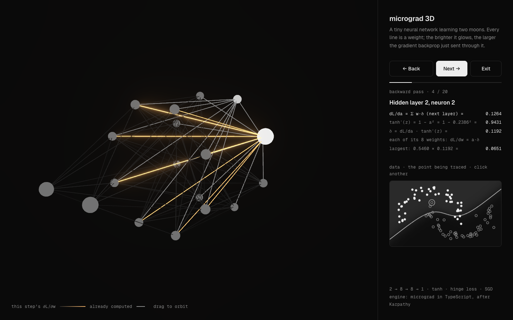

# micrograd 3D



Watch a tiny neural network learn, in 3D. A 2 → 8 → 8 → 1 network learns to separate two
interleaving half-moons while every weight is drawn as a line that glows when backprop sends a
large gradient through it. Pause at any moment and step through one point's backward pass,
neuron by neuron, with the chain rule written out.

For CS students learning backprop. The autograd engine is
[Karpathy's micrograd](https://github.com/karpathy/micrograd), rewritten from scratch in TypeScript.

## Run it

```bash
npm install
npm run dev      # http://localhost:5173
npm test         # engine tests: hand-computed gradients, finite differences, chain rule per edge
npm run build    # typecheck + production build into dist/
```

Keys: <kbd>Space</kbd> play / pause · <kbd>→</kbd> one training step · <kbd>R</kbd> reset ·
<kbd>B</kbd> step through backprop (then <kbd>←</kbd> <kbd>→</kbd>, <kbd>Esc</kbd> to leave).

## How it works

1. `Value` (`src/engine/value.ts`) is one number that remembers which numbers made it and how to pass a gradient back to them.
2. `backward()` sorts the graph so every node comes after its inputs, sets the output's gradient to 1, and walks the list in reverse, applying the chain rule at each node.
3. `Neuron`, `Layer` and `MLP` (`nn.ts`) are just weighted sums of `Value`s followed by `tanh`.
4. Each training step builds the hinge loss over all 100 points, calls `backward()`, and nudges every weight against its gradient (plain SGD).
5. The 3D view (React Three Fiber, loaded lazily) colours each edge by |∂L/∂w| from that step; bloom makes the largest ones glow.
6. Backprop mode rebuilds one point's graph, runs the same `backward()`, and replays it neuron by neuron: δ = (Σ w·δ) · tanh′(z), ∂L/∂w = a·δ.

Spec and design decisions: [SPEC.md](SPEC.md).

## License

MIT. See [LICENSE](LICENSE).

Built with Claude.
